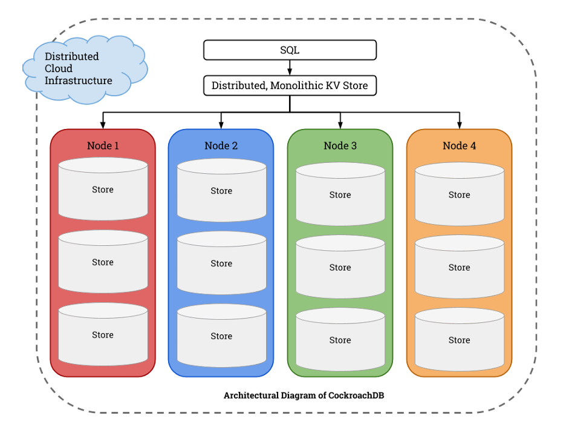

# Distributed Database with Oracle and CockroachDB

## Scope

1. **CockroachDB setup and synthetic e-commerce data**
2. **Multi-node Python queries, failover, load balancing and transaction retry**
3. **CRUD latency, throughput, follower-read visibility and failover tests**
4. **Oracle → CockroachDB migration with CSV and optional Airflow orchestration**

## CockroachDB Architecture

<p align="center">
  
</p>

## Project structure

```text
.
├── Req1_IntroductionToCockroachDB/
├── Req2_MultiMachineSetup/
│   └── ETL/
├── Req3_DataOperationsAndReplication/
├── Req4_RDBMSMigration/
│   └── dags/
├── .env.example
├── .gitignore
├── requirements.txt
└── requirements-airflow.txt
```

## Quick start

```bash
python -m venv .venv
```

Windows:

```bash
.venv\Scripts\activate
```

Linux/macOS:

```bash
source .venv/bin/activate
```

Install dependencies:

```bash
pip install -r requirements.txt
```

Copy configuration:

```bash
cp .env.example .env
```

On Windows:

```bat
copy .env.example .env
```

Edit `.env` with your CockroachDB and Oracle information.

## CockroachDB schema

```bash
cockroach sql --host=<HOST>:26257 --insecure < Req1_IntroductionToCockroachDB/create_tables.sql
cockroach sql --host=<HOST>:26257 --insecure --database=ecommerce < Req1_IntroductionToCockroachDB/insert_data.sql
```

## Multi-node query test

```bash
cd Req2_MultiMachineSetup
python test_connect.py
python query1.py
python query2.py
python query3.py
python query4.py
python query5.py
python query6.py
```

## Benchmark

```bash
cd ../Req3_DataOperationsAndReplication
python crud_latency.py
python throughput.py
python replication_lag.py
```

## Oracle → CockroachDB migration

```bash
cd ../Req4_RDBMSMigration
python 01_create_schema.py
python 02_dump_oracle.py
python 03_load_to_crdb.py
python 05_verify.py
```
